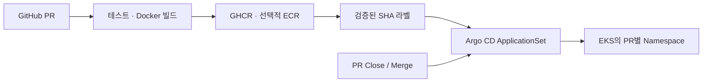

# PReview

PR을 열면 독립된 테스트 환경을 만들고, 새 커밋을 반영하며, PR 종료 시 환경을 회수하는 프로젝트입니다.

[](https://github.com/ASBG-PReview/PReview/actions/workflows/ci.yaml)

## 구조

하나의 저장소에서 역할별 디렉터리를 구분합니다. 작은 팀이 앱·배포·CI 변경을 한 PR로 검증할 수 있고, PR 번호와 이미지 SHA를 연결하기 쉽습니다. 독립된 서비스나 운영 권한 경계가 생길 때 GitOps 저장소를 분리합니다.

```text
app/               FastAPI 데모 + 최소 화면 + Dockerfile
helm/preview-demo/ PR별 Namespace, Deployment, Service, 격리 정책
argocd/            AppProject + ApplicationSet
.github/           CI, 이미지 발행, ECR 정리, main 보호 규칙
infra/aws/         OIDC/IAM/ECR 설정 예시
scripts/           검증·발행 정책·정리 도구
docs/              설계 결정, 설치, 테스트, 시연 절차
```



## 빠른 실행

```sh
docker compose up --build -d
curl http://localhost:8000/health
curl http://localhost:8000/pr-info
docker compose down
```

화면: http://localhost:8000 · API: `/health`, `/version`, `/pr-info`

Python만 사용할 때:

```sh
python -m venv .venv
# Windows: .venv\Scripts\activate 또는 MSYS Python의 .venv/bin/activate
# Linux/macOS: source .venv/bin/activate
python -m pip install -r requirements-dev.txt
python -m pytest -q
python -m uvicorn app.main:app --reload
```

## GitHub 흐름

1. `codex/…`, `feat/…`, `fix/…` 브랜치에서 PR을 엽니다.
2. Python 테스트, Helm 렌더링, 실제 Docker 실행 검증을 수행합니다.
3. 같은 저장소의 권한 있는 작성자가 만든 PR은 성공한 CI 이미지가 GHCR로 발행됩니다.
4. 이미지 준비 후 `preview-ready`, `sha-<40자리 SHA>` 라벨을 기록합니다.
5. Argo CD를 설치하면 해당 이미지로 환경을 생성·갱신하고 PR 종료 시 제거합니다.
6. main 병합은 승인 1명, 최신 CI 통과, 대화 해결이 필요합니다. 관리자 우회도 허용하지 않습니다.

외부 fork와 Dependabot은 CI만 실행합니다. 발행 워크플로는 main의 코드만 실행하며 PR 코드를 실행하지 않습니다. `preview-ready`는 이미지 준비 완료이며 Kubernetes 배포 성공을 보장하지 않습니다.

## AWS 연결

기본값 `AWS_PREVIEW_ENABLED=false`: GitHub/Docker 검증에 AWS 계정이 필요하지 않습니다.
EKS, ECR, IAM, Ingress, 도메인은 별도 준비 대상이며 **이 저장소만으로 AWS 리소스가 생성되지는 않습니다**.
EKS 등 AWS 실행 비용은 GitHub 무료 플랜과 별개입니다.

- [설치 및 AWS 연결](docs/installation.md)
- [설계와 저장소 분리 기준](docs/architecture.md)
- [검증 계획](docs/test-plan.md)
- [시연 절차](docs/demo-script.md)
- [협업 규칙](CONTRIBUTING.md)

GHCR 패키지는 최초 발행 시 비공개일 수 있습니다. EKS에서는 ECR 사용을 권장하며, GHCR을 사용할 때에는 패키지 공개 여부 또는 imagePullSecrets를 따로 설정하세요.
